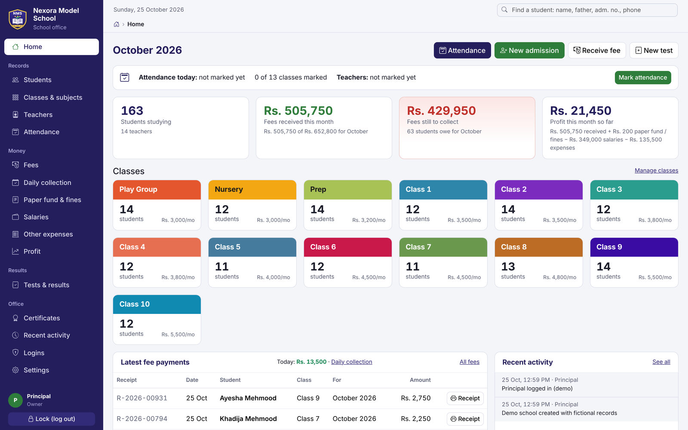
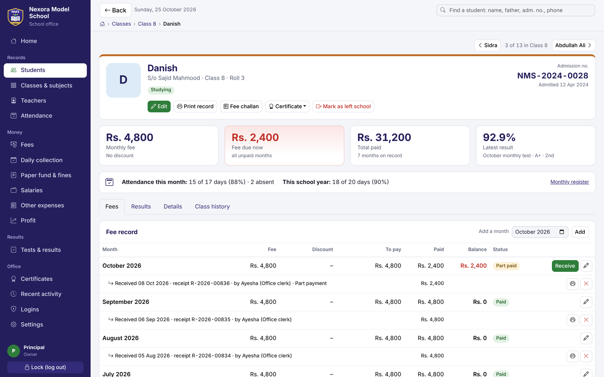
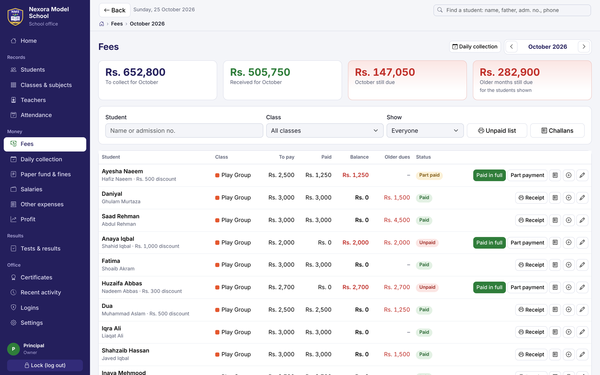
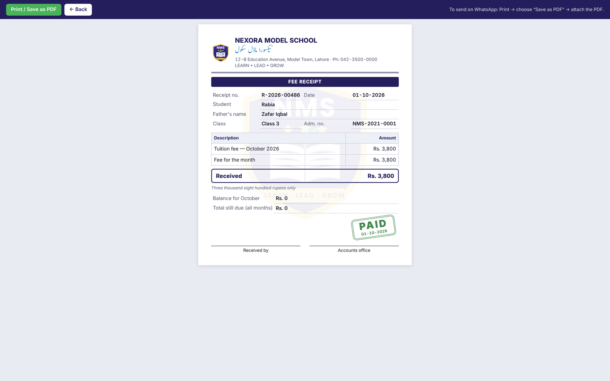
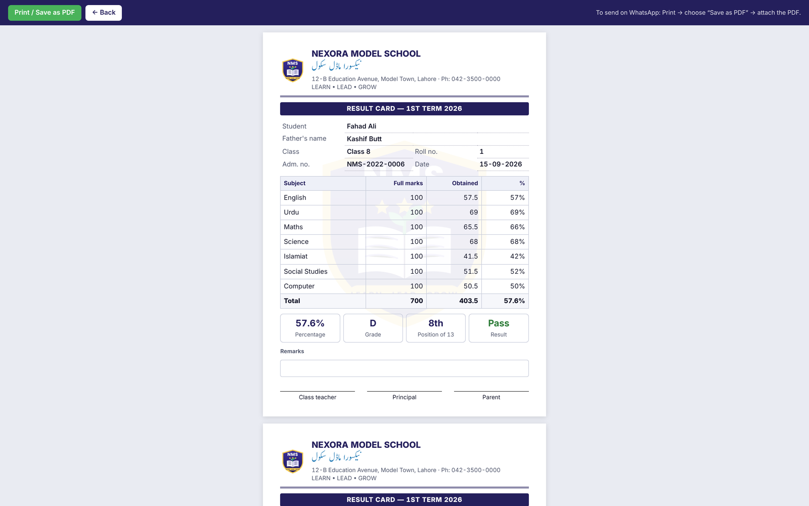
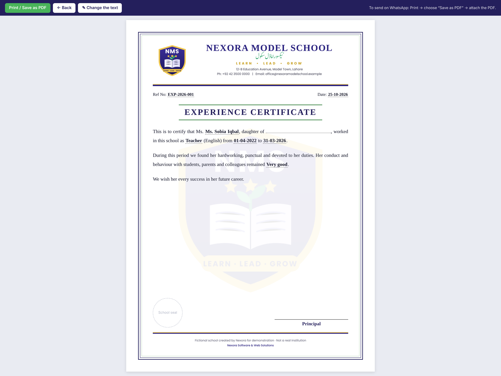
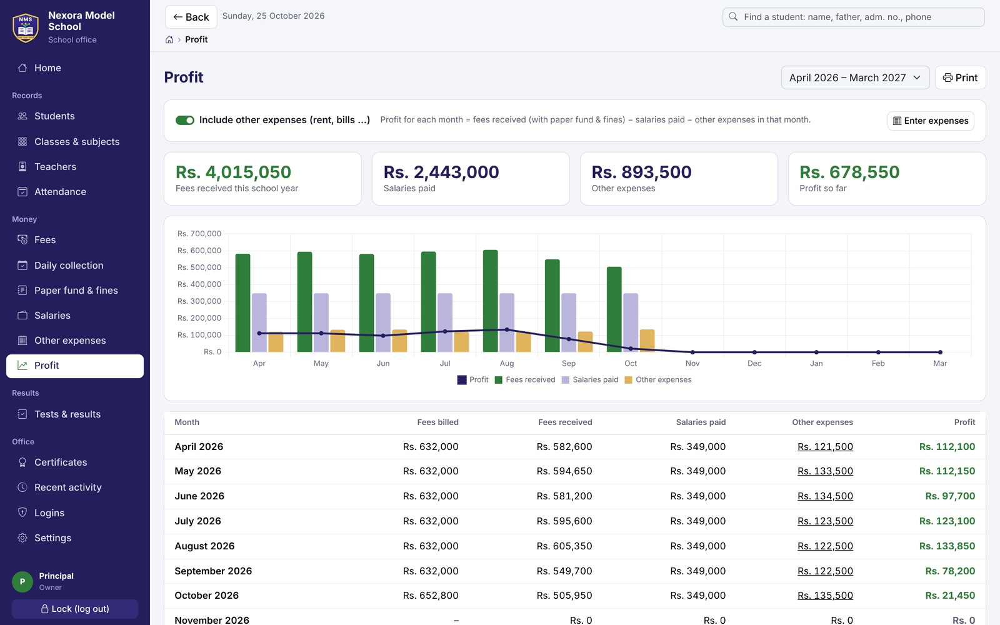
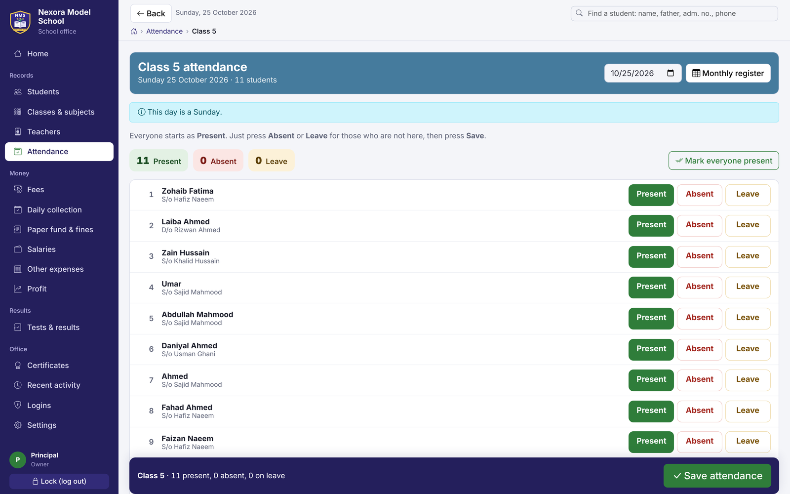
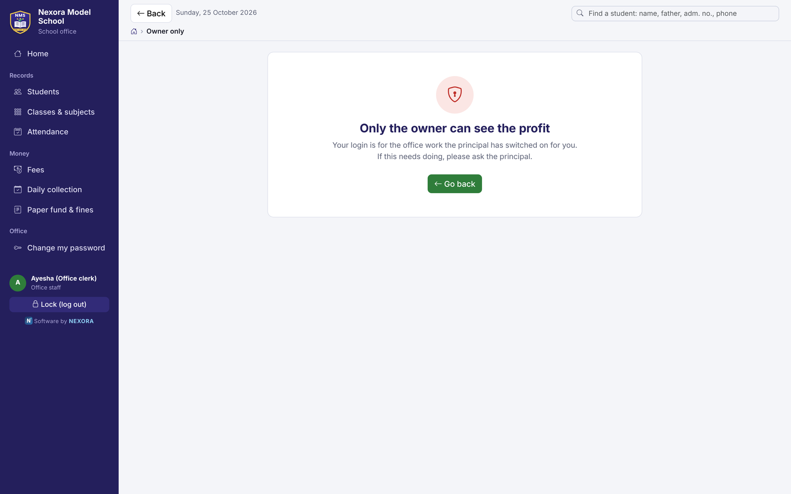
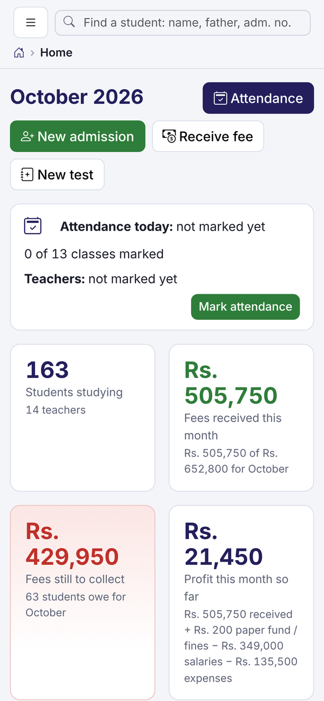

<div align="center">

# Nexora School Office

**Offline school office system for Pakistani private schools — fees and receipts, challans, attendance, results, certificates in English and Urdu, salaries and profit.**

[](https://nexoraschool90.pythonanywhere.com)
&nbsp;




</div>

## The problem

A typical private school office keeps fees in a register, writes receipts by hand and types certificates in Word.
At the end of the month nobody knows exactly who still owes fees, whether the school made a profit, or whether
a staff member quietly lowered someone's fee.

## The solution

School Office runs on the school's own office computer and needs **no internet**. The principal sees the whole school
on one screen; office staff get their own logins with only the work the principal switches on for them.
Everything that touches money is recorded with who did it and when.

It was first built for the office of a real private school. This public edition uses a **fictional school,
"Nexora Model School"**, and contains none of that school's records.

> **Try it:** the [live demo](https://nexoraschool90.pythonanywhere.com) signs you in with one click as the
> *Principal*, an *Office clerk* or an *Exams teacher*. About 160 made-up students; the data resets every 24 hours.

## Features

| Area | What it does |
|---|---|
| **Students** | Admissions with automatic numbers (NMS-2026-0001), photos, B-Form, per-student fee and discount, left/passed-out history, live search by name, father's name, phone or admission no. |
| **Fees** | One-click monthly fees for the whole school, part payments, receipts with a PAID stamp, fee challans with all unpaid months, unpaid lists, daily collection with a cash check |
| **Paper fund & fines** | Paper fund, late and absence fines for a student or a whole class — added to the fee challan or kept separate with its own receipt |
| **Attendance** | Students (present, absent, leave) and teachers (also late), monthly registers ready to print |
| **Tests & results** | Monthly tests and term exams, marks entry, percentage, grade, position, remarks, printed result cards and class result sheets |
| **Certificates** | School leaving, character, date of birth, matric passing, experience, relieving and appreciation letters on the school letterhead — editable wording with live preview, Urdu supported |
| **Teachers & salaries** | Staff records, monthly salary sheet, salary slips |
| **Profit** | Month-by-month profit for the school year (April–March): fees received − salaries − expenses, with chart |
| **Promotion** | Move every class up for the new year in one step, keep class history, undo the last promotion |
| **Logins & safety** | Owner and staff logins; changing fees, deleting anything, salaries and profit always stay with the owner; blocked attempts are logged; weekly backup reminder to a USB stick |

## Screenshots

| | |
|---|---|
| <br>**Student profile** — fees, results, attendance | <br>**Monthly fees** — collect, part-pay, challans |
| <br>**Fee receipt** with PAID stamp | <br>**Result card** — grade and class position |
| <br>**Certificate on letterhead** (English + Urdu) | <br>**Profit** for the school year |
| <br>**Attendance** marking | <br>**Staff limits** — owner-only pages are blocked and logged |

<p align="center"><br><em>Works on a phone browser too</em></p>

## How it works

- **Server-rendered Django app** with a small amount of JavaScript for live search, keyboard shortcuts and charts — fast on old office PCs.
- **Access rules in one place** (`office/access.py`): every page is checked by middleware against the owner/staff permissions,
  and blocked attempts are written to the activity log.
- **Numbers that can't be fudged:** receipt, slip and certificate serial numbers are generated inside a database transaction;
  fee changes and deletions are owner-only.
- **Print-ready documents:** receipts, challans, result cards, registers and certificates have their own print stylesheet and
  can be saved as PDF and sent on WhatsApp.
- **Fully offline:** Bootstrap, icons, Chart.js and fonts (including the Urdu Nastaleeq font) are bundled; one SQLite file holds every record.

## Tech stack

**Backend:** Python 3, Django 5.2, SQLite, Pillow · **Frontend:** Django templates, Bootstrap 5, Bootstrap Icons, Chart.js, vanilla JavaScript ·
**Deployment:** Windows setup script with a desktop shortcut; public demo on PythonAnywhere

## Project structure

```
config/       settings and URLs
office/       models, access rules, views (students, fees, attendance, tests, certificates, salaries, reports),
              certificate wording, search, demo-data builder, tests
templates/    pages, print layouts (receipts, challans, result cards, certificates), login
static/       CSS, JavaScript, fonts, school logo and letterhead
deploy/       PythonAnywhere demo configuration
```

## Run it

**Windows (the real product):** install Python 3.10+, double-click `setup.bat`, then the **Nexora School Office** desktop icon.
The first start asks the principal to choose a password; school name, logo and letterhead are set in **Settings**.
Full guide: [docs/USER_GUIDE.md](docs/USER_GUIDE.md).

**Developers:**

```bash
python -m venv venv && . venv/bin/activate        # Windows: venv\Scripts\activate
pip install -r requirements.txt
python manage.py migrate
python manage.py test office                       # 56 tests
python manage.py runserver 127.0.0.1:8765
```

## Tests

56 automated tests cover admission numbering, fee generation and part payments, salaries and profit, test results and positions,
search, promotion and undo, paper fund and fines, certificates, backups, staff permissions and the public demo mode.

## Author

**Talha Zubair** — Nexora Software & Web Solutions
Business software for schools, travel agencies and small businesses in Pakistan.
📧 nexoraservices90@gmail.com · 🐙 [@talhazubair2401](https://github.com/talhazubair2401)

<sub>© 2026 Talha Zubair. All rights reserved — see [LICENSE](LICENSE).</sub>
